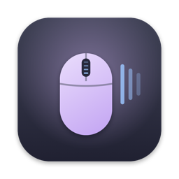
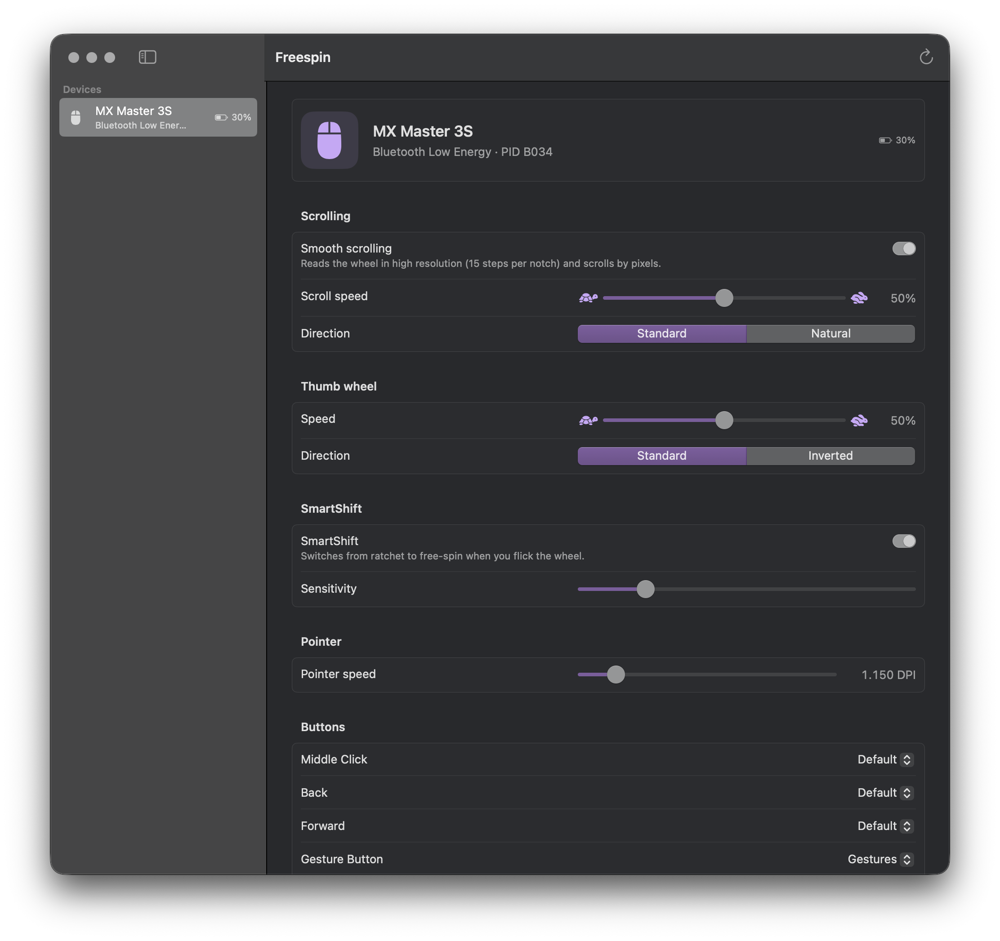
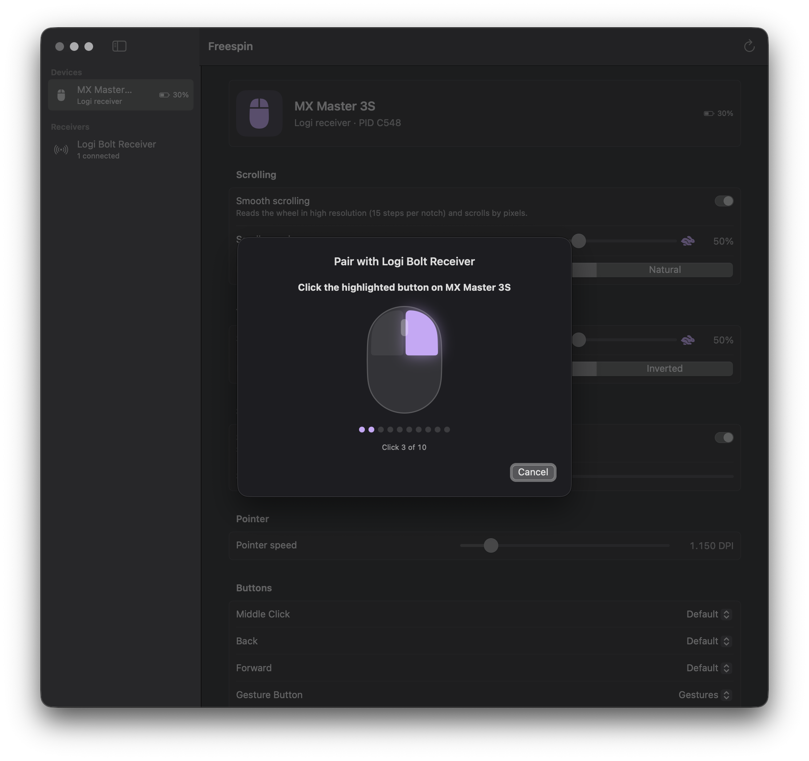

<p align="center"></p>

<h1 align="center">Freespin</h1>

<p align="center">A native Swift replacement for Logi Options+ on macOS, built from a reverse-engineered spec of how Options+ really scrolls.</p>

<p align="center"></p>

## Why

Logi Options+ is a 541 MB Electron app plus a 310 MB native agent with a Qt runtime, an updater, analytics and cloud accounts, all to tune a mouse. Freespin is one 2.8 MB SwiftUI app that talks HID++ to the device directly and reproduces Options+'s smooth scrolling from its decompiled algorithm.

## Freespin vs Options+

Measured on the same Mac (macOS 27.0.1, Apple silicon) with an MX Master 3S over Bluetooth, Options+ 2.6.944893.

| | Freespin | Logi Options+ |
|---|---|---|
| Install size | **2.8 MB** (1.7 MB executable) | **851 MB** (541 MB app + 310 MB agent bundle) |
| Processes, window open | **1** | **6** (UI, GPU, renderer and utility helpers, agent, updater) |
| Memory, window open | **65 MB** | **≈ 602 MB** (renderer 240, agent 166, GPU 100, UI 51, updater 38, utility 7) |
| Memory, running in background | **45 MB** | **179 MB** (agent 143, updater 36) |
| Idle CPU, in background (30 s average) | **0.10 %** | **2.03 %** |
| Runtime | Swift, SwiftUI, IOKit, CoreGraphics | Electron (Chromium + Node), C++ agent on Qt 5.15 |
| Account, cloud, analytics | none | yes |

Memory is the physical footprint reported by `top`. Idle CPU is the process's CPU time over 30 s with nothing happening (`ps -o cputime`), with each app driving the wheel on its own.

## Features

- **Smooth scrolling that matches Options+.** The wheel is diverted to HID++ high-resolution reports (15 steps per notch on the MX Master 3S) and run through a port of Options+'s `wheel_mouse_handler`: period timing, hysteresis, ratchet detection, middle-click suppression and its exact acceleration curve. A port of its injector turns the result into continuous pixel scroll events with the same line and fixed-point fields. Recorded traces match Options+ in event structure and ≈10.3 vs 10.4 px per line.
- **Scroll speed and direction**, and native line scrolling when smooth scrolling is off (the wheel is handed back to macOS).
- **Thumb wheel** horizontal scrolling with its own speed and direction.
- **SmartShift**: on/off, sensitivity, and ratchet force on wheels that have it.
- **Pointer speed** (DPI).
- **Buttons**: remap Middle, Back, Forward, Gesture and Mode Shift to Back/Forward, Middle Click, Mission Control, App Exposé, Show Desktop, Launchpad, desktop left/right, Screenshot, Gestures or the Actions Ring.
- **Gesture button**: click, or hold and move for Mission Control, App Exposé and switching desktops. An experimental "trackpad swipes" style uses the Dock's swipe gestures instead of shortcuts.
- **Actions Ring**: hold a button and a radial menu of eight actions appears at the cursor; move toward one and release.
- **Per-app settings**: different scroll speed, smoothness, direction or buttons while a given app is frontmost.
- **Logi Bolt and Unifying receivers**: devices behind a receiver show up and disconnect live, and you can pair and unpair from the app. Bolt pairing uses the same two-button confirmation as Options+, one highlighted button at a time.
- **Low-battery notifications** at 15 % and 5 %.
- **Keyboard**: Fn-key inversion and backlight for Logitech keyboards that support them (implemented, not yet tested on hardware).
- A regular windowed app. Closing the window keeps the mouse working; quitting gives the wheel back to macOS.

Not included: Flow, Smart Actions (macros), firmware updates, accounts, analytics, webcam and presenter features.

<p align="center"></p>

Tested on an MX Master 3S over Bluetooth and through a Logi Bolt receiver. Other HID++ 2.0 mice and Unifying receivers use the same code paths but haven't been tried yet.

## Build

Requires Xcode 16+ (Swift 6 toolchain) and macOS 14+.

```fish
swift test                                # unit tests
./scripts/build-app.sh                    # → build/Freespin.app (ad-hoc signed)
SIGN_IDENTITY="Developer ID Application: …" ./scripts/build-app.sh   # stable identity keeps permissions across rebuilds
open build/Freespin.app
```

On first launch macOS asks for **Input Monitoring** (to read the mouse) and **Accessibility** (to post scroll and key events), and Freespin asks to send notifications.

Quit Logi Options+ first; two apps driving the same wheel fight each other. To unload its background agent:

```fish
launchctl bootout gui/(id -u)/com.logi.cp-dev-mgr
# bring it back later:
launchctl bootstrap gui/(id -u) /Library/LaunchAgents/com.logi.optionsplus.plist
```

`freespinctl` is a command-line companion for inspecting and debugging devices:

```fish
swift run freespinctl list        # devices, battery, DPI
swift run freespinctl features    # HID++ feature table
swift run freespinctl controls    # divertable buttons and their reporting state
swift run freespinctl receivers   # Bolt/Unifying receivers and their devices
swift run freespinctl pair        # pair a new device to the receiver
swift run freespinctl sniff       # print HID++ notifications
swift run freespinctl trace out.jsonl   # record wheel reports and scroll events
swift run freespinctl run         # headless scroll engine
```

## How it works

```
MX Master 3S ──HID++ 2.0 over BLE/USB/Bolt──► HIDPP (IOHIDManager)
   0x2121 hi-res wheel · 0x2150 thumb wheel · 0x1B04 buttons · 0x2111 SmartShift · 0x2201 DPI · 0x1004 battery
        │
        ▼
ScrollEngine ── WheelProcessor (timing, hysteresis, ratchet, disturbance filter, acceleration curve)
        │        ScrollInjectorModel (sub-pixel remainders, 10 px lines, 16.16 fixed point)
        ▼
EventSynth ── CGEvent scroll/key/mouse/dock-swipe synthesis
        ▲
FreespinCore ── device sessions, settings, per-app profiles, battery alerts
        ▲
FreespinApp ── SwiftUI window
```

| Package | Role |
|---|---|
| `HIDPP` | IOKit transport, HID++ framing, request/response matching, typed features |
| `ScrollEngine` | Pure-Swift port of the Options+ wheel pipeline (no AppKit, deterministic, unit-tested) |
| `EventSynth` | Posting scroll, key and mouse events; gesture and Actions Ring logic |
| `FreespinCore` | Discovery, per-device sessions, settings store, frontmost-app tracking |
| `FreespinApp` / `freespinctl` | The app and the CLI |

The spec comes from static analysis of the shipped Options+ agent (Hopper via REA, `otool`, embedded protobuf descriptors and the deobfuscated Electron bundle) and live HID++ traces. The notes are in [`re/notes/`](re/notes). No Logitech code or assets are included in this repository.

## Disclaimer

An independent project for interoperability, not affiliated with or endorsed by Logitech. "Logitech", "Logi", "Options+", "MX Master", "SmartShift" and "Flow" are trademarks of Logitech.
